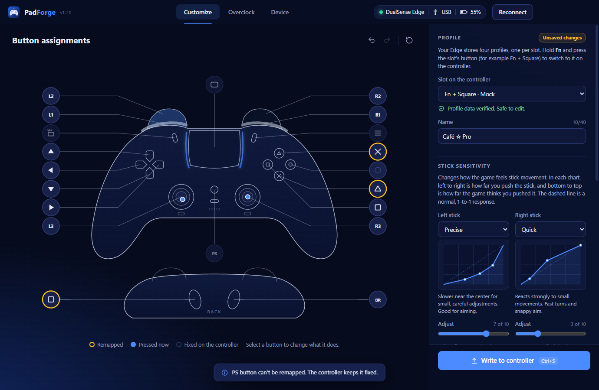
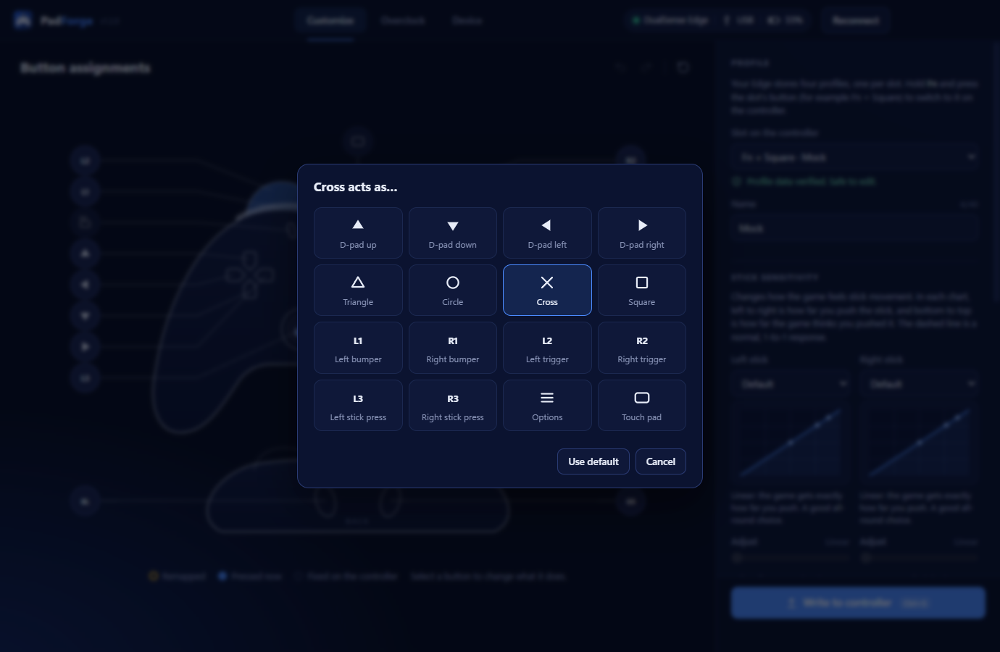
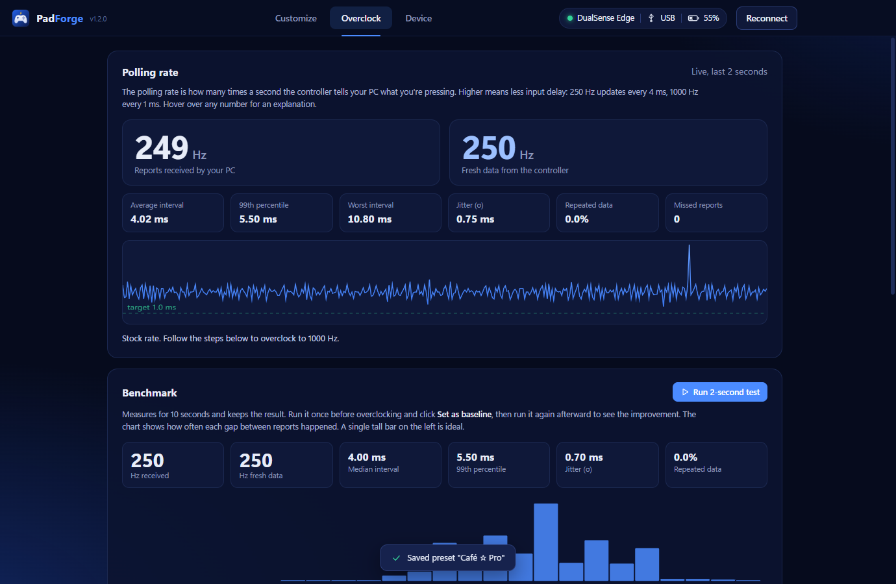
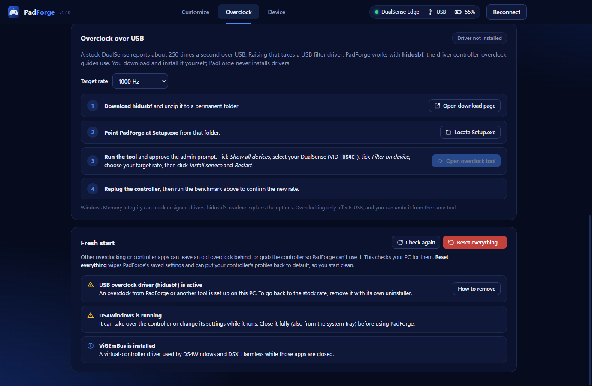
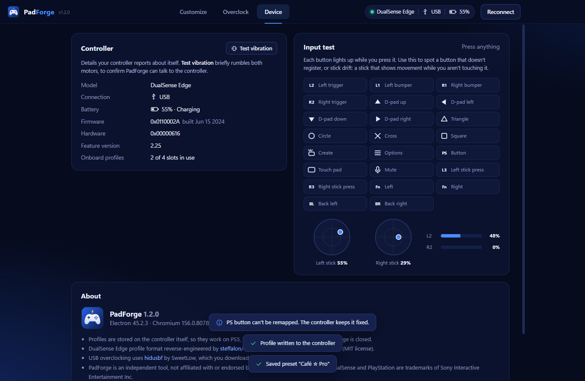

<p align="center"></p>

<h1 align="center">PadForge</h1>

<p align="center">
  Remap buttons, tune sticks and triggers, and overclock the polling rate of your <b>DualSense Edge</b>, all in one Windows app.
</p>

<p align="center">
  <a href="https://github.com/process631/padforge/releases/latest"></a>
  <a href="https://github.com/process631/padforge/actions/workflows/test.yml"></a>
  
  <a href="LICENSE"></a>
</p>

<p align="center"></p>

## Download

1. Open the **[latest release](https://github.com/process631/padforge/releases/latest)**.
2. Download **`PadForge-1.2.0-Portable.exe`**. It runs without installing. The **`PadForge-Setup-1.2.0.exe`** download installs PadForge with Start menu and desktop shortcuts instead.
3. Double-click it. Windows SmartScreen will say *"Windows protected your PC"* because the app isn't code-signed; click **More info → Run anyway**.
4. Plug in your controller with a USB cable. PadForge connects automatically.

Requires Windows 10 or 11 (64-bit).

## Features

### Customize: profiles stored on the controller
- Remap the D-pad, face buttons, L1/R1/L2/R2 and stick presses on any of the four **Fn + button** profiles. Back-button remapping is experimental.
- Rename profiles, pick a stick response curve (Default, Quick, Precise, Steady, Digital, Dynamic) with a live curve chart, and set L2/R2 trigger ranges.
- **Safe writes:**
  - The profile's checksum is verified first.
  - All four slots are backed up automatically.
  - The controller is read back to confirm the write.
  - **Restore backup** undoes any write.
- Undo and redo, unsaved-changes warnings, and presets you can export and share as files.
- Profiles live on the controller, so they keep working on PS5 and PC even when PadForge is closed.

<p align="center"></p>

### Overclock: measure and raise the USB polling rate
- Live polling rate measured two ways: reports received by your PC, and fresh data according to the controller's own clock. The second number reveals overclocks that only repeat old data.
- Jitter, 99th percentile, missed and repeated reports, a live graph, and a 10-second benchmark with a before/after baseline.
- Step-by-step guide for [hidusbf](https://github.com/LordOfMice/hidusbf), the USB filter driver used for controller overclocking, with driver detection. PadForge never installs drivers itself.
- **Fresh start:**
  - Finds leftovers and conflicts on your PC: an old overclock driver, apps that grab the controller (DSX, DS4Windows, reWASD, Steam) and HidHide.
  - Walks you through removing an old overclock safely.
  - **Reset everything** wipes PadForge's settings and presets and puts the controller's profiles back to default. The profiles are backed up first.

<p align="center"></p>
<p align="center"></p>

### Device
Model, connection, battery, firmware version, a vibration test, and a live tester for every button, stick and trigger.

<p align="center"></p>

**Shortcuts:** `Ctrl+Z` / `Ctrl+Y` undo and redo · `Ctrl+S` write to controller · `Ctrl+1/2/3` switch tabs

## Good to know
- Options, Touch pad, Create and PS can't be remapped. The controller keeps them fixed.
- An empty profile slot must be created once in Sony's PlayStation Accessories app before PadForge can edit it.
- Editing profiles needs a USB cable. Overclocking only applies to USB.
- The Edge profile format is reverse-engineered and unofficial. If a write ever misbehaves, use **Restore backup** and open an issue with the file from **Device → Export diagnostics**. It contains the raw profile data and recent log, and no personal information.

## Build from source

Requires [Node.js](https://nodejs.org) 22 or newer.

```powershell
npm install
npm start            # run in development
npm test             # protocol unit tests
npm run selftest     # drive the real UI against a simulated DualSense Edge (40 checks)
npm run dist         # tests + self-test, then the installer and portable exe in dist/
```

```
src/shared/     dualsense.mjs (HID report codecs), edge.mjs (onboard profile protocol)
src/main/       Electron main process and the preload bridge
src/renderer/   UI: controller diagram, curve chart, polling meter, device, dialogs
scripts/        build (esbuild), self-test runner, icon renderer
test/           unit tests
```

The shipped app is hardened:
- context isolation, a sandboxed renderer and a strict Content Security Policy
- Electron fuses: no RunAsNode, asar integrity checking, and the app loads only from its asar archive
- no developer tools or reload shortcuts in release builds

## Credits
- The DualSense Edge profile format was reverse-engineered by [steffalon/dualsense-edge-profile-web-application](https://github.com/steffalon/dualsense-edge-profile-web-application) (MIT). See [THIRD_PARTY_NOTICES.txt](THIRD_PARTY_NOTICES.txt).
- Input and output report layouts follow the Linux `hid-playstation` driver (used as a reference only).

PadForge is an independent project and is not affiliated with or endorsed by Sony Interactive Entertainment. DualSense and PlayStation are trademarks of Sony Interactive Entertainment Inc.

## License
[MIT](LICENSE)
